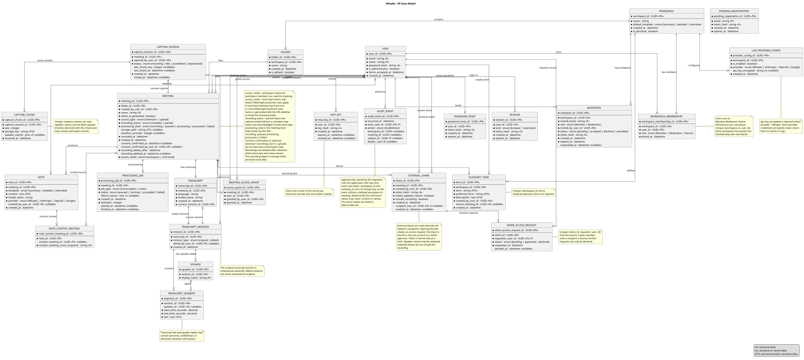

# Whadio Data Model

This document describes the Whadio ER data model.

Source: [uml/er-model.puml](uml/er-model.puml)

The model covers the data required for these key project functions:

1. Recording, upload and processing: `US-003`, `US-004`, `US-009`.
2. Speaker labeling and correction: `US-005`.
3. Notes generation, folder-scoped context and BYOK provider configuration: `US-006`, `US-007`, `US-008`, `US-010`.
4. Workspaces, folders, roles and restricted meeting access: `US-002`, `US-013`, `US-014`, `US-015`.
5. Transcript editing with original provenance retained: `US-011`.
6. Workspace glossary management: `US-012`.
7. External sharing, export and MCP access: `US-016`, `US-017`, `US-018`.
8. Accountability for changes to meeting content and access: `NFR-010`.
9. Registration, invitations and password recovery: `US-001`, `US-002`, `US-020`.

## Notation

- `PK` means primary key.
- `FK` means foreign key.
- `P` marks personal data.
- `S` marks sensitive, confidential, or secret data.
- Fields marked as both `P/S` may contain either personal data, confidential meeting content, or both.

## Core Entities

| Entity | Primary key | Purpose | Personal or sensitive data |
| --- | --- | --- | --- |
| `USER` | `user_id` | Registered account that can create workspaces, meetings, exports, shares, and MCP keys; `is_administrator` marks system administrators, and `terms_accepted_at` records when the Terms and Conditions were accepted. | `email`, `name` are personal. `password_hash` is sensitive. |
| `WORKSPACE` | `workspace_id` | Collaboration boundary for members, folders, glossary terms, meetings, the default notes template, and LLM configuration. `is_personal` marks the personal workspace created during registration. | Usually not personal, but the workspace name may reveal an organization or project. |
| `WORKSPACE_MEMBERSHIP` | `workspace_membership_id` | Connects users to workspaces and stores their cumulative role: `Member`, `Moderator`, or `Owner`. | Membership and role data can be sensitive organizational metadata. |
| `INVITATION` | `invitation_id` | Pending, accepted, declined, or cancelled workspace invitation for an email address with a chosen role, reached through a single-use link that expires. | `invited_email` is personal data. `token_hash` is sensitive. Invitation metadata can reveal team membership. |
| `PENDING_REGISTRATION` | `pending_registration_id` | Registration started from an email address, by a visitor or by the operator, and waiting for its link to be opened; becomes a `USER` when completed. | `email` is personal data of someone who may never complete registration. `token_hash` is sensitive. |
| `PASSWORD_RESET` | `password_reset_id` | Pending password reset for an account, requested by its owner or issued by the operator. | `token_hash` is sensitive. |
| `SESSION` | `session_id` | A signed-in browser session or an extension token, held server-side so that it can be revoked. | `token_hash` is sensitive. Session rows reveal when an account signed in. |
| `FOLDER` | `folder_id` | Organizes meetings inside a workspace. Folders do not define permissions. | Folder names may reveal topics or projects. |
| `MEETING` | `meeting_id` | Meeting metadata, generated-name state, source type, recording completeness, meeting-level processing state, consent confirmation, recording location, retention state, and access mode. | `name`, `storage_path`, timestamps, duration, and consent-confirmation metadata can be sensitive; the recording path points to highly sensitive audio. |
| `CAPTURE_SESSION` | `capture_session_id` | Browser recording session used by the extension for chunked upload, idle-timeout recovery, and partial recording assembly. | Links a user to a recording action and may reveal meeting timing. |
| `CAPTURE_CHUNK` | `capture_chunk_id` | Acknowledged uploaded audio chunk with sequence number, object-storage key, and speaker events observed by the extension. | `storage_key` references audio chunks containing personal voice data and sensitive meeting content. `speaker_events` may contain participant names and active-speaker timing. |
| `MEETING_ACCESS_GRANT` | `access_grant_id` | Explicit access list used when a meeting is restricted to selected workspace members. | Reveals who can access a specific meeting. |
| `EXTERNAL_SHARE` | `share_id` | Read-only signed-in sharing outside the workspace, bound to the one account its creator approves, with revocation and optional speaker-name redaction. | `token_hash` is sensitive. `recipient_user_id` is personal data. Share metadata reveals external disclosure. |
| `SHARE_ACCESS_REQUEST` | `share_access_request_id` | Request to read a shared meeting, created when a signed-in account opens the share link; the share's creator approves or declines it. | `requester_user_id` is personal data: it links a person outside the workspace to a meeting they tried to open. |
| `TRANSCRIPT` | `transcript_id` | Transcript container for one meeting, including language, recognition model, and current revision. | Transcript metadata may be sensitive. |
| `TRANSCRIPT_REVISION` | `revision_id` | Preserves the original transcript and all edited versions. | Edit history and editor identity may be sensitive. |
| `SPEAKER` | `speaker_id` | Speaker labels stored per transcript revision, so speaker renames preserve the original labels and create edited revisions. | `display_name` is personal data. |
| `TRANSCRIPT_SEGMENT` | `segment_id` | Time-coded transcript text linked to a transcript revision and optional speaker. | `text` can contain personal data, confidential topics, or secrets. |
| `GLOSSARY_TERM` | `term_id` | Workspace-specific terms and preferred spellings used to improve recognition. | Terms, names, and descriptions may contain personal or confidential information. |
| `NOTE` | `note_id` | Generated meeting notes for a fixed preset. | `content` may contain personal data and confidential meeting decisions. |
| `NOTE_CONTEXT_MEETING` | `note_context_meeting_id` | Records the meetings used as context for a generated note, including a name snapshot so notes remain understandable after a context meeting is deleted. | `context_meeting_name_snapshot` can reveal sensitive meeting topics. |
| `LLM_PROVIDER_CONFIG` | `provider_config_id` | Workspace notes-provider configuration, either built-in `Whadio` or an external BYOK provider. | `api_key_encrypted` is secret credential material when an external provider is used. |
| `MCP_KEY` | `mcp_key_id` | Personal access key for MCP clients. | `key_hash` is sensitive authentication material. |
| `PROCESSING_JOB` | `processing_job_id` | Tracks transcription and notes jobs for monitoring. Diarization is part of the transcription job. | Failure reasons can include sensitive operational or content-derived details. |
| `AUDIT_EVENT` | `audit_event_id` | Append-only record of who changed a meeting's content or access (`NFR-010`), kept after the meeting or workspace it refers to is deleted. | `actor_user_id` links a person to their actions. `subject_id` and `details` hold user IDs for membership, access-grant and share-request events. No content or names. |

## Relationships and Cardinality

- One `USER` has one or more `WORKSPACE_MEMBERSHIP` rows because registration creates a personal workspace.
- One `WORKSPACE` has one or more `WORKSPACE_MEMBERSHIP` rows because every workspace has an Owner.
- Every `WORKSPACE` has exactly one `WORKSPACE_MEMBERSHIP` row with `role = Owner`.
- One `WORKSPACE` contains one or more `FOLDER` records because every workspace has a default folder.
- One `WORKSPACE` can have many `INVITATION` rows.
- One `USER` has zero or one `PASSWORD_RESET`.
- One `USER` has zero or many `SESSION` rows.
- `PENDING_REGISTRATION` is related to no other entity, because the account it leads to does not exist yet.
- One `FOLDER` contains many meetings; each meeting belongs to exactly one folder.
- One `USER` can create many meetings; each meeting has one creator.
- One extension-recorded `MEETING` has zero or one `CAPTURE_SESSION`; uploaded meetings have none.
- One `CAPTURE_SESSION` has many `CAPTURE_CHUNK` rows.
- One unrestricted meeting is available to all workspace members. A restricted meeting must have one or more `MEETING_ACCESS_GRANT` rows.
- One `MEETING` can have many `EXTERNAL_SHARE` rows, each created by one user and revocable independently.
- One `EXTERNAL_SHARE` is bound to zero or one recipient `USER`, set when its creator approves a request.
- One `EXTERNAL_SHARE` has many `SHARE_ACCESS_REQUEST` rows; each request is made by one `USER`.
- One `MEETING` has zero or one `TRANSCRIPT`; one transcript has one or more `TRANSCRIPT_REVISION` rows.
- One `TRANSCRIPT_REVISION` has many `TRANSCRIPT_SEGMENT` rows.
- One `TRANSCRIPT_REVISION` has many `SPEAKER` rows; each segment may reference one speaker label from the same revision.
- One `WORKSPACE` has many `GLOSSARY_TERM` rows.
- One `MEETING` can produce many `NOTE` rows, for example from different presets or regenerations.
- One `NOTE` can reference many context meetings through `NOTE_CONTEXT_MEETING`.
- One `WORKSPACE` has zero or one active `LLM_PROVIDER_CONFIG`.
- One `USER` can create many `MCP_KEY` rows.
- One `MEETING` can have many `PROCESSING_JOB` rows.
- One `USER` performs many `AUDIT_EVENT` rows; each event has exactly one actor.

## Integrity Rules

- Every entity has a UUID primary key.
- `MEETING.name_is_generated` is `true` when the meeting name was proposed by the system and the SPA should prompt the user to confirm or rename it; it becomes `false` after the user provides a name.
- `MEETING.storage_path` and `MEETING.duration_seconds` are optional while an extension recording is still being captured and before chunks have been assembled.
- `MEETING.recording_status = partial` means the capture ended without a complete stop event, for example after a lost connection or closed tab, but already acknowledged chunks were stored. Partial recordings must be shown as partial and must not be treated as complete meeting records.
- `MEETING.processing_state` is the meeting-level state shown in the SPA: `recording`, `queued`, `processing`, `processed`, or `failed`.
- `MEETING.consent_confirmed_at` and `MEETING.consent_confirmed_by_user_id` are optional because extension recordings require consent confirmation, while uploaded recordings do not have the extension consent step.
- `CAPTURE_SESSION.last_chunk_seq` and `CAPTURE_SESSION.last_chunk_at` are optional until the first chunk arrives; after that, they let the scheduler find captures that have been idle past the timeout.
- `CAPTURE_CHUNK` must be unique by `(capture_session_id, seq)`, so chunk upload retries are idempotent.
- A workspace must always have exactly one membership with `role = Owner`.
- `WORKSPACE_MEMBERSHIP` must be unique by `(workspace_id, user_id)`, so one user has at most one role in a workspace.
- `INVITATION.role` is limited to `Member` or `Moderator`; invitations cannot grant `Owner`. No `INVITATION` exists for a workspace with `is_personal = true`.
- `USER.email` is unique. Email addresses are compared case-insensitively everywhere, including `INVITATION.invited_email` and `PENDING_REGISTRATION.email`.
- A `USER` row is created in one of two ways: by completing a `PENDING_REGISTRATION`, taking its email, or by redeeming an `INVITATION`, taking `invited_email`. A `PENDING_REGISTRATION` is started by a visitor in `verified` mode or issued by the operator in either mode. Both forms set `name`, `password_hash` and `terms_accepted_at`, so no account's email is only typed in at sign-up.
- Creating a `USER` deletes any `PENDING_REGISTRATION` for its email in the same transaction, so a registration started before an invitation for the same address was redeemed cannot complete.
- `PENDING_REGISTRATION` is unique by `email`, and none exists for an email that already has a `USER`. A registration request for an email that has a `USER` is handled as a password-reset request for that `USER`.
- Completing a `PENDING_REGISTRATION` deletes it in the same transaction that creates the `USER`, its personal workspace and its default folder, which makes its link single-use.
- `PASSWORD_RESET` is unique by `user_id`, and using the link deletes the row.
- Visitors can request registrations and password resets only in `verified` mode; the operator issues them in either mode. Rows created before a mode switch keep working until they expire.
- A repeated registration or password-reset request within 20 minutes of the existing row's `created_at` changes nothing, so it cannot invalidate a link already sent. A later one replaces `token_hash`, `created_at` and `expires_at`, so earlier links stop working.
- At most one `INVITATION` per `(workspace_id, invited_email)` has `status = pending`. Inviting an address that already has a pending invitation in the workspace updates that invitation, keeping its `invitation_id`: it replaces `token_hash`, `role`, `invited_by_user_id`, `created_at` and `expires_at`, so earlier links stop working, and writes another `member_invited` event.
- In `verified` mode, inviting an address is refused within a day of the `created_at` of its latest invitation to the workspace, whatever that invitation's status, so cancelling and inviting again sends no extra email. Invitation rows are kept until they expire, so the latest one is still there to compare with.
- A `USER` invites at most 20 addresses a day, counted as the `INVITATION` rows whose `invited_by_user_id` is that user and whose `created_at` falls within the last 24 hours. A replaced invitation stays one row and counts once, for whoever replaced it last. That undercounts nothing the limit protects: in `verified` mode an invitation is replaced only after it has left the count, so every invitation email is counted, and in `invite-only` mode repeated replacements send no email and can create at most one account.
- An invitation link works only while `status = pending`, `expires_at` has not passed, and `invited_by_user_id` still holds `Moderator` or `Owner` in the workspace; neither expiry nor the inviter's lost role is stored as a status. Accepting requires the account's email to equal `invited_email`. Accepting, declining or cancelling moves `status` off `pending`, which makes the link single-use.
- Registration, password-reset, invitation and session tokens are stored only as `token_hash`. Each `expires_at` is set at creation from the lifetime stated in the requirements.
- `SESSION.token_hash` is unique, and `SESSION.expires_at` is never extended. Signing out deletes the session's row, and setting a new password through a reset deletes every `SESSION` of the user in the same transaction. A session with `kind = extension` is accepted only by the Capture API and by signing out, which only deletes the presented session. A `browser` session lasts 14 days and an `extension` one 24 hours (FR-003).
- The scheduler deletes `PENDING_REGISTRATION`, `PASSWORD_RESET`, `SESSION` and `INVITATION` rows past their `expires_at`, whatever an invitation's status, so an invited address is kept at most 7 days.
- `GLOSSARY_TERM` must be unique by `(workspace_id, term)`, because duplicate glossary terms are rejected.
- `GLOSSARY_TERM.source_meeting_id` is optional and records the meeting where a transcript correction produced the term.
- Workspace roles are cumulative: `Owner` includes `Moderator` permissions, and `Moderator` includes `Member` permissions.
- Folders do not grant or restrict access. Meeting access is determined by workspace membership plus the meeting's `access_mode`, and for people outside the workspace, an active `EXTERNAL_SHARE` bound to them.
- If `MEETING.access_mode = workspace`, all workspace members can access the meeting.
- If `MEETING.access_mode = restricted`, only users listed in `MEETING_ACCESS_GRANT` can access the meeting.
- A restricted meeting must not be used as cross-meeting context for another meeting's notes.
- External shares are read-only, require a signed-in recipient, can be revoked, and must store only `token_hash`, never a raw share token.
- An external share grants access only to its `recipient_user_id`. While it is null, opening the link only creates a `SHARE_ACCESS_REQUEST`; approving a request sets `recipient_user_id` to the requester.
- Only the share's creator (`EXTERNAL_SHARE.created_by_user_id`) approves or declines its requests. Once `recipient_user_id` is set, further requests can only be declined.
- `SHARE_ACCESS_REQUEST` must be unique by `(share_id, requester_user_id)`, so an account cannot repeat a declined request.
- If an external share has `redact_speaker_names = true`, it must not include the meeting recording.
- A transcript's first revision must have `revision_type = original`.
- The original transcript revision must be retained permanently. Edited transcript text or speaker-label changes create edited revisions and must not overwrite the original.
- `TRANSCRIPT.current_revision_id` must point to a revision belonging to the same transcript.
- `NOTE.created_by_user_id` is optional because first notes may be generated automatically; regenerations can store the requesting user.
- `NOTE_CONTEXT_MEETING.context_meeting_id` is optional so the note can remain unchanged after a context meeting is deleted; `context_meeting_name_snapshot` preserves what was shown to readers.
- `LLM_PROVIDER_CONFIG.api_key_encrypted` is required unless `provider = Whadio`.
- `PROCESSING_JOB.created_at` stores when the job was queued, and `attempts` stores retry count for monitoring and retry limits.
- Segment time intervals must satisfy `start_time_seconds < end_time_seconds`.
- Recording files are deleted after the retention date stored in `recording_delete_after`; transcripts and notes remain after `recording_deleted_at` is set.
- LLM provider API keys and MCP keys must never be stored in plaintext.
- `AUDIT_EVENT` is append-only: the table is owned by the migration role, and the application's database role holds only `INSERT` and `SELECT` on it.
- An `AUDIT_EVENT` is written in the same transaction as the change it records, by the module that performs the change.
- `AUDIT_EVENT.workspace_id` and `AUDIT_EVENT.meeting_id` carry no foreign key: a cascading key would delete the events together with the workspace or meeting, and a restricting one would block the deletion.
- `AUDIT_EVENT.workspace_id` is null only for `mcp_key_*` actions, since MCP keys belong to a user; `meeting_id` is null for workspace- and account-level actions.
- `AUDIT_EVENT.details` holds IDs and enum values only, never transcript, note or recording content, and never meeting or workspace names.
- For `meeting_evicted`, `actor_user_id` is the account whose new meeting triggered the eviction, and `details` holds that meeting's ID.

## Audit Actions

`AUDIT_EVENT.action` takes one of these values. The writer is the module that performs the change; `subject_id` identifies what the action affected, and its type follows from the action.

| Writer | Action | `subject_id` | `details` |
| --- | --- | --- | --- |
| Meetings | `meeting_created` | — | — |
| Meetings | `meeting_renamed` | — | — |
| Meetings | `meeting_moved` | — | from and to `folder_id` |
| Meetings | `meeting_deleted` | — | — |
| Meetings | `meeting_evicted` | — | the triggering `meeting_id` |
| Meetings | `transcript_edited` | new `revision_id` | — |
| Meetings | `speaker_renamed` | new `revision_id` | — |
| Meetings | `notes_regenerated` | — | preset |
| Access Policy | `meeting_restricted`, `meeting_unrestricted` | — | — |
| Access Policy | `access_granted`, `access_revoked` | the member's `user_id` | — |
| Access Policy | `share_created`, `share_revoked` | `share_id` | — |
| Access Policy | `share_access_approved`, `share_access_declined` | `share_id` | the requester's `user_id` |
| Accounts & Workspaces | `member_invited` | `invitation_id` | role |
| Accounts & Workspaces | `invitation_cancelled` | `invitation_id` | — |
| Accounts & Workspaces | `member_joined`, `member_removed` | the member's `user_id` | role |
| Accounts & Workspaces | `member_role_changed` | the member's `user_id` | old and new role |
| Accounts & Workspaces | `workspace_deleted` | — | — |
| Accounts & Workspaces | `provider_configured` | — | provider, enabled |
| Accounts & Workspaces | `mcp_key_created`, `mcp_key_revoked` | `mcp_key_id` | — |

Restricting a meeting writes `meeting_restricted` and one `access_granted` per selected member; unrestricting writes only `meeting_unrestricted`. Deleting a folder writes one `meeting_moved` per meeting it moves to the default folder. Deleting or evicting a meeting writes one `meeting_deleted` or `meeting_evicted`; its shares and access grants disappear with it without events of their own. Deleting a workspace writes only `workspace_deleted`, not an event per meeting. `notes_regenerated` is written when the regenerated notes are saved, with the requester from `NOTE.created_by_user_id`, so a failed run writes nothing.

Changes the system makes on its own are not recorded, because they have no actor: Retention's deletion of recordings, the assembly of an interrupted capture, the first notes and the generated meeting name. Glossary changes are not recorded either: they affect later transcriptions, not an existing meeting, and `GLOSSARY_TERM.created_by_user_id` records who added a term. Registration, password resets and sign-ins are not recorded: they change no meeting content or access. Joining through an invitation writes `member_joined`. An invitation that stops working because its creator lost the Moderator role writes nothing, since nothing in it changes.

## Personal and Sensitive Data Starting Points for Threat Analysis

The highest-risk data stores are:

- Meeting recordings referenced by `MEETING.storage_path`; the object itself contains personal voice data.
- Meeting names in `MEETING.name`, especially generated names based on transcripts.
- Consent confirmation metadata in `MEETING.consent_confirmed_at` and `MEETING.consent_confirmed_by_user_id`.
- Capture chunks referenced by `CAPTURE_CHUNK.storage_key`.
- Speaker events in `CAPTURE_CHUNK.speaker_events`.
- Transcript text in `TRANSCRIPT_SEGMENT.text`.
- Speaker names in `SPEAKER.display_name`.
- Generated notes in `NOTE.content`.
- Note context meeting snapshots in `NOTE_CONTEXT_MEETING.context_meeting_name_snapshot`.
- Glossary terms when they contain names, internal terminology, or project details.
- LLM provider credentials in `LLM_PROVIDER_CONFIG.api_key_encrypted`.
- MCP credentials in `MCP_KEY.key_hash`.
- External share tokens represented by `EXTERNAL_SHARE.token_hash`.
- Registration, password-reset, invitation and session tokens represented by `PENDING_REGISTRATION.token_hash`, `PASSWORD_RESET.token_hash`, `INVITATION.token_hash` and `SESSION.token_hash`; a session token signs its holder in as the account.
- Addresses in `PENDING_REGISTRATION.email` and `INVITATION.invited_email`, kept only until the link expires; those in pending registrations belong to people who may never complete registration.
- Share recipients and requesters in `EXTERNAL_SHARE.recipient_user_id` and `SHARE_ACCESS_REQUEST.requester_user_id`, which reveal who outside the workspace read or tried to open a meeting.
- Audit actors and subjects in `AUDIT_EVENT.actor_user_id`, `subject_id` and `details`, which reveal who did what to which meeting, and outlive the meeting itself.

These fields should drive the next threat-analysis step, especially for access control, logging, export handling, retention, encryption, and external provider use.

## AI Usage

This document and the accompanying data model diagram were prepared and revised with the assistance of Codex (GPT-5.5) and Claude Code (Claude Opus 5.5) and discussed in the working session of 2026-09-26. Reviewed by the author and the team before committing.
