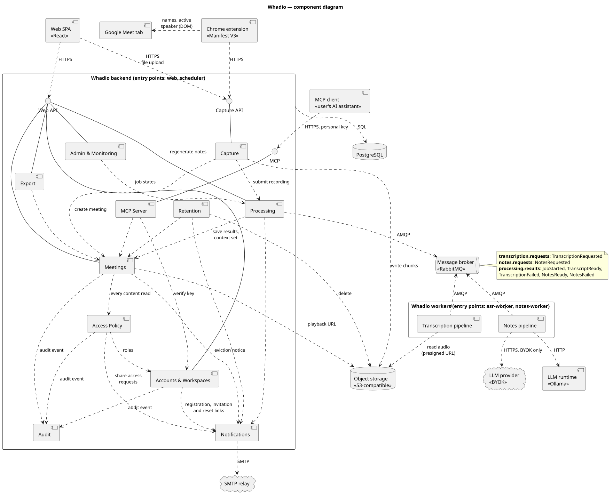
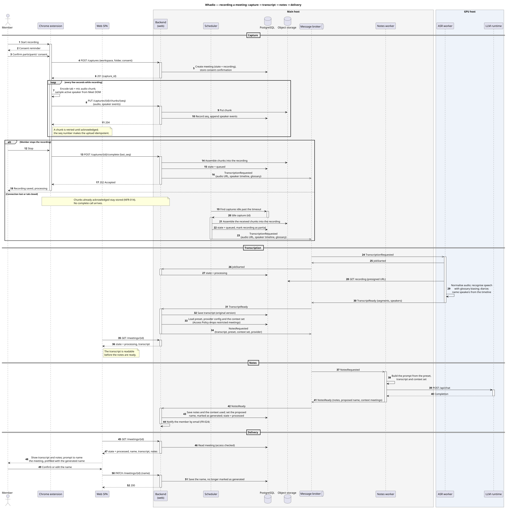
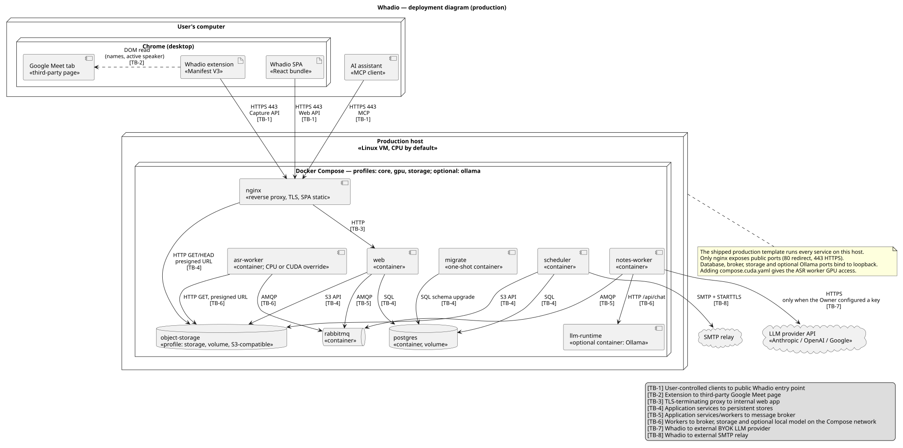

# High-Level Design

The architectural overview of Whadio: the chosen style, the components and their interfaces, the
main flow and the deployment. It builds on the [requirements](../requirements/requirements.md) and
is traced back to them in [traceability-matrix.md](traceability-matrix.md). The data behind the
components is described in [data-model.md](data-model.md), and the key decisions in the ADRs
under [decisions/](decisions/). Diagram sources live in [uml/](uml/).

## 1. Architectural drivers

The requirements that shape the architecture most, and what each one forces.

| Driver | Source | Consequence |
|---|---|---|
| A failure of transcription or note generation must not make the whole service unavailable. | NFR-015 | Machine-learning work runs in separate processes that the backend reaches only through a message broker. |
| Meetings already received stay stored while processing is unavailable. | NFR-014 | Durable queues and object storage live on the always-on main host; a job waits until a worker takes it. |
| A one-hour recording is transcribed within 15 minutes in 90% of runs. | NFR-002 | Speech recognition runs on a GPU; the GPU host stays on in the reference deployment. |
| The open-source build can be installed outside the team's hosting, given stated resources. | NFR-016, NFR-017 | One container image and Docker Compose profiles; the same system runs on one machine or two. |
| Without a configured provider, no request leaves the system; provider keys are the Owner's alone. | FR-021, FR-022, NFR-013 | The built-in language model runs inside the deployment. Only the notes worker calls an external provider, and only with the Owner's key. |
| Meeting content reaches only those with access, on every path. | NFR-007, NFR-009, FR-037, FR-044 | One Access Policy module sits on every read path. Workers receive only data the backend has already authorised. |
| GPU time is the dominant running cost (about $2 per hour on a cloud GPU instance). | Team session 2026-09-24 | GPU work is isolated on its own host, which can be sized, placed and switched off without touching the rest. |
| One team of four, one repository, one semester. | [Team Charter](../../TeamCharter.md) | No microservices: there are no independent release cycles to gain, while the full cost of operating a distributed system would still be paid. |

## 2. Architectural style

**A modular monolith with broker-driven worker processes.**

- **One codebase, one container image, four entry points.** `web` serves the HTTP interfaces,
  `scheduler` runs periodic jobs, and `asr-worker` and `notes-worker` consume jobs from the broker.
  Each entry point is a separate process with its own lifecycle, started by a different command.
- **Layered inside the backend.** Each backend module has an API, a domain and a persistence layer,
  and owns its own tables.
- **Client–server at the edge.** The Chrome extension, the web SPA and the user's MCP client talk to
  the backend over HTTPS.
- **Asynchronous messaging between the backend and the workers.** The backend orchestrates the
  pipeline; the workers are stateless consumers.

### Dependency rules

1. Worker code never imports backend modules or the database layer. The backend and the workers
   share only the Job contracts library. The rule is checked in CI by an import-linter contract.
2. Workers have no access to PostgreSQL. Everything a job needs arrives in its message, audio is
   read through a presigned URL, and results return as messages.
3. On the backend side, only the Processing module talks to the broker.
4. Every read of meeting content goes through Meetings, which consults Access Policy.

### Alternatives considered

| Alternative | Why it was rejected |
|---|---|
| Microservices, one service per capability | The benefit of microservices is independent ownership and release by separate teams. With one team and one repository that benefit is absent, while distributed transactions, per-service data stores and several deployment pipelines would still have to be paid for. |
| A single-process monolith, with models loaded in the web process | A GPU out-of-memory error or a model crash would take the web application down (NFR-015), and the web host would need a GPU. |
| Choreography: the transcript event consumed by both the backend and the notes worker | Notes need the context set, the preset and the provider configuration, which only the backend can assemble under the access rules (FR-019, FR-037). Notes could also arrive before the transcript is saved, and regeneration (FR-025) starts from the backend anyway. |
| A database table as the job queue | With several workers, a shared table needs claiming and skipping logic that a broker provides natively. A queue also gives backpressure: the GPU takes one job at a time while peaks wait in the queue. |
| Splitting the ASR worker into a thin worker on the main host and a model server on the GPU host, as is done for notes | The notes split relies on an off-the-shelf server with a standard API, an interchangeable external provider (BYOK) and a secret to keep on the main host. None applies to transcription: no standard API covers recognition with glossary biasing and diarization, audio may not leave Whadio's servers, and the job carries no secret. A job of several minutes would also need an asynchronous API on the model server, duplicating the broker. The choice is internal to the Transcription pipeline and can be revisited without changing the messages. |

## 3. Components

Source: [uml/component-diagram.puml](uml/component-diagram.puml)

### Clients

| Component | Responsibility | Requirements |
|---|---|---|
| Chrome extension | Consent confirmation, tab and microphone capture, chunked upload, reading participant names and the active speaker from the Meet page. | FR-009, FR-010, FR-011, FR-016 |
| Web SPA | The user interface for workspaces, meetings, transcripts, notes, sharing, export and administration; file upload. | FR-013, FR-031, FR-032 and the interface side of the other FRs |
| MCP client | The user's own AI assistant; external to Whadio. | FR-043, FR-044 |

### Backend modules

| Component | Responsibility | Requirements |
|---|---|---|
| Capture | Capture sessions, idempotent chunk storage, assembling the recording, validating uploaded files, finalising interrupted captures. | FR-009, FR-010, FR-012, FR-013 |
| MCP Server | The MCP interface: authenticates personal keys and exposes the key owner's meetings as tools. | FR-043, FR-044 |
| Accounts & Workspaces | Registration, sign-in, workspaces, membership and roles, LLM provider configuration, MCP keys. Checks workspace-administration permissions against the member's role. | FR-001–FR-003, FR-005–FR-008, FR-021, FR-043 |
| Access Policy | Decides who may read which meeting: workspace role, per-meeting restriction, share grants and redaction. | FR-004, FR-037–FR-039, FR-044, NFR-007–NFR-009 |
| Meetings | Meetings, folders, transcript and notes versions, speaker labels, naming, glossary, playback. The single read path for meeting content. | FR-017, FR-027–FR-036 |
| Processing | The pipeline's orchestrator: publishes jobs, consumes results, tracks processing state, assembles the context set, limits regeneration. | FR-012, FR-014, FR-015, FR-018–FR-020, FR-022, FR-023, FR-025, FR-026 |
| Export | Markdown and VTT export with the consent notice and attribution. | FR-040–FR-042 |
| Notifications | Email to members when processing finishes or fails, and before recordings expire. | FR-024, FR-046 |
| Retention | Deletes recordings three months after the meeting and triggers the advance warning. | FR-046 |
| Admin & Monitoring | The administrator dashboard: queue, failures, load and model usage, without meeting content. | FR-045 |

The Web API has no component of its own: each module serves its own resources through its API
layer. Session authentication is middleware that Accounts & Workspaces provides to every Web API
route. MCP Server, by contrast, is a component, because it carries behaviour of its own: a separate
protocol, authentication by personal key, the tool definitions, and the rule that a key reaches only
its owner's accessible meetings (FR-043, FR-044).

Access Policy governs meeting content. Workspace administration, such as inviting members or
configuring the provider, is checked by Accounts & Workspaces against the member's role.

### Worker modules

| Component | Responsibility | Requirements |
|---|---|---|
| Transcription pipeline | Audio normalisation, speech recognition with glossary biasing (Parakeet or Whisper), diarization (pyannote), naming speakers from the Meet timeline. | FR-015, FR-016, FR-029 |
| Notes pipeline | Builds the prompt from the preset, transcript and context set; calls the built-in model or the configured provider; proposes the meeting name. | FR-018, FR-021–FR-023, FR-033 |

### Infrastructure

| Component | Role |
|---|---|
| PostgreSQL | The backend's data; each module owns its tables. |
| Object storage (S3-compatible) | Audio chunks and recordings. Any server that implements the S3 API with presigned URLs fits; the product is a deployment choice (for example SeaweedFS or Garage). |
| Message broker (RabbitMQ) | Job and result queues between the backend and the workers. |
| LLM runtime | An off-the-shelf server exposing an OpenAI-compatible chat completions API for the built-in model (for example llama.cpp server or vLLM). |
| LLM provider | An external API used only when the workspace Owner configured a key. |
| SMTP relay | Delivers notification email. |

## 4. Runtime units

The deployable processes, all but the off-the-shelf services built from the same image.

| Unit | Runs | Host | Instances |
|---|---|---|---|
| `web` | All backend modules except Retention; consumes `processing.results` | Main host | 1, stateless; more can run behind nginx |
| `scheduler` | Retention, capture finalisation, re-publishing jobs stuck in `queued` | Main host | Exactly 1 |
| `notes-worker` | Notes pipeline | Main host (CPU only) | 1 or more, competing consumers |
| `asr-worker` | Transcription pipeline | GPU host | 1 per GPU |
| `llm-runtime` | The built-in language model, on an off-the-shelf server | GPU host | 1 |
| `nginx`, `postgres`, `rabbitmq`, `object-storage` | Off-the-shelf services | Main host | 1 each |

The notes worker needs no GPU: the model runs in `llm-runtime`, and the worker only builds the
prompt and calls it. When every workspace uses its own provider key, `llm-runtime` can be stopped
without touching the notes worker.

## 5. Interfaces

The interfaces between the components in the [component diagram](#3-components). Endpoint paths and
message schemas are specified with the API design, not here.

| Interface | Provider → consumers | Protocol | Purpose | Authentication |
|---|---|---|---|---|
| Web API | Accounts & Workspaces, Meetings, Processing, Export, Admin & Monitoring → Web SPA | HTTPS, JSON | Workspaces, members, meetings, transcripts, notes, glossary, sharing, export and administration; the SPA polls a meeting's processing state. | Session |
| Capture API | Capture → Chrome extension, Web SPA | HTTPS | Resumable upload of a recording in chunks, with the speaker events observed during each; upload of an existing file. | Session, or a token issued to the extension at sign-in |
| MCP | MCP Server → the user's AI assistant | MCP over HTTPS | Listing, searching and reading the meetings the key's owner has access to. | Personal key, stored hashed |
| Job queues | Message broker ↔ Processing, Transcription pipeline, Notes pipeline | AMQP | Transcription and notes jobs from the backend to the workers; progress, results and failures back. | Separate broker credentials per runtime unit |

**Job delivery.** A worker acknowledges a job only after publishing its result, so every job is
delivered at least once and the backend ignores a duplicate result. Each worker takes one job at a
time, which gives backpressure: load peaks wait in the queue instead of overloading the GPU. A job
that keeps failing is retried up to a limit and then recorded as failed. A job carries everything the
worker needs, so workers never read the database; audio is fetched through a time-limited presigned
URL, and a workspace's own provider key travels only to the notes worker on the main host.

**Infrastructure.** The backend uses PostgreSQL over SQL and object storage over the S3 API, and
sends email to the SMTP relay over SMTP with STARTTLS. The notes worker calls `llm-runtime` over an
OpenAI-compatible HTTP API, and the configured provider over HTTPS.

## 6. Main flow

The critical scenario: a member records a Google Meet call, and the transcript and notes reach
them.

Source: [uml/sequence-meeting-pipeline.puml](uml/sequence-meeting-pipeline.puml)

1. **Capture.** After the member confirms consent, the extension opens a capture and streams audio
   chunks together with the speaker events it reads from the Meet page. Each acknowledged chunk is
   stored at once.
2. **Interrupted capture.** If the connection is lost or the tab is closed, the chunks already
   acknowledged stay stored. Once the capture has been idle past a timeout, the scheduler assembles
   what was received into a partial recording and queues it like any other.
3. **Transcription.** The ASR worker takes the job, reports that it started, fetches the audio,
   and returns the transcript with named speakers. The backend saves it, and the member can read it
   while the notes are still being generated.
4. **Notes.** The backend assembles the preset, the provider and the context set, excluding
   restricted meetings, and queues the notes job. The notes worker returns the notes, the proposed
   name and the meetings used as context.
5. **Delivery.** The backend saves the notes, applies the proposed name as the meeting's name,
   marked as generated, marks the meeting processed and emails the member. The SPA shows the
   transcript and notes and prompts for a name, prefilled with the generated one; if the member
   does not answer, the generated name stays (FR-033).

## 7. Failure behaviour

How the architecture meets fault tolerance (NFR-015) and recoverability (NFR-014).

| Failure | What keeps working | What happens to new work |
|---|---|---|
| GPU host or ASR worker down | Everything except new transcripts; recordings keep arriving. | Jobs wait in `transcription.requests` and run when a worker returns. |
| LLM runtime or notes worker down | Transcripts are readable. | Notes jobs wait in `notes.requests`; the meeting shows its transcript while processing. |
| The configured provider fails | Transcripts are readable. | The meeting is failed with the cause, and generation with the built-in model is offered (FR-023). |
| Notes generation fails, so no name is proposed | The transcript and the meeting itself. | The meeting keeps a default name built from its date and time until the member names it or notes are regenerated (FR-033). |
| A job fails repeatedly | Everything else. | Past the delivery limit, the meeting is failed with the cause and the member is notified (FR-014, FR-024). |
| The extension loses its connection | Acknowledged chunks stay stored. | The scheduler finalises a partial recording. |
| Broker down | Reading, editing, sharing, export. | Meetings stay `queued`; the scheduler re-publishes jobs stuck in `queued` once the broker is back. |
| Main host down | Nothing. | Availability is deliberately not among the requirements: a single main host cannot guarantee it. |

## 8. Deployment

Source: [uml/deployment-diagram.puml](uml/deployment-diagram.puml)

### Nodes

| Node | Runs | Exposed |
|---|---|---|
| User's computer | Chrome with the extension, the Meet tab and the SPA; the user's MCP client | — |
| Main host (Linux, CPU only) | Docker Compose profile `core`: nginx, `web`, `scheduler`, `notes-worker`, PostgreSQL, RabbitMQ, object storage | HTTPS 443 (nginx), the private network's endpoint |
| GPU host (Linux, NVIDIA GPU) | Docker Compose profile `gpu`: `asr-worker`, `llm-runtime` | Nothing; it joins the private network from the inside |
| Third parties | LLM provider API, SMTP relay | — |

nginx terminates TLS, serves the SPA, proxies the Web, Capture and MCP interfaces to `web`, and
enforces request-size and rate limits. There is no load balancer: one `web` instance is enough at
the project's scale, and more can be added as an nginx upstream later.

The two hosts are joined by a private network: traffic between them is encrypted and never reaches
a public port. The GPU host reaches the broker and object storage, and the notes worker reaches its
LLM runtime, only over this network, and the GPU host holds no database or storage credentials. The
private network must work with the GPU host behind NAT, so that it can be a team member's computer;
its implementation, such as a WireGuard tunnel or a Tailscale or Headscale mesh, is a deployment
choice that does not change the architecture.

### Deployment profiles

- **Two hosts (reference production).** The layout above. The GPU host stays on so that NFR-002
  holds; starting it only when jobs are waiting would add boot and model-loading time to the
  turnaround.
- **One host (self-hosting, development).** Both Compose profiles run on a single machine with a
  GPU, with no private network. On a machine without a GPU, the quantized CPU models are used (see the
  hardware assumptions in the [project description](../../Project-Description.md)).

## 9. Evolution

The architecture leaves room for these changes without restructuring:

- **Starting the GPU host on demand** when `transcription.requests` is not empty, since jobs already
  wait durably in the queue.
- **More `web` instances** behind nginx, since `web` keeps no state in memory.
- **A separate GPU for `llm-runtime`** if note generation becomes the bottleneck: only its placement
  changes.
- **Post-correction of low-confidence words** by the built-in model, using the workspace glossary,
  inside the Transcription pipeline and without changing any message. It is deferred because it
  needs requirements that do not yet exist: corrected words marked apart from recognised ones, and
  correction restricted to the built-in model. It would also keep `llm-runtime` running for every
  transcription, including in workspaces that use their own provider.

## AI Usage

This document and its diagrams were prepared with the assistance of Claude Code (Claude Opus 5.5).
The architecture follows the decisions of the team's working session of 2026-09-24 and the
architecture-lead decisions that followed it. The author reviewed and edited the content, and the
document is reviewed through a pull request before merging.
