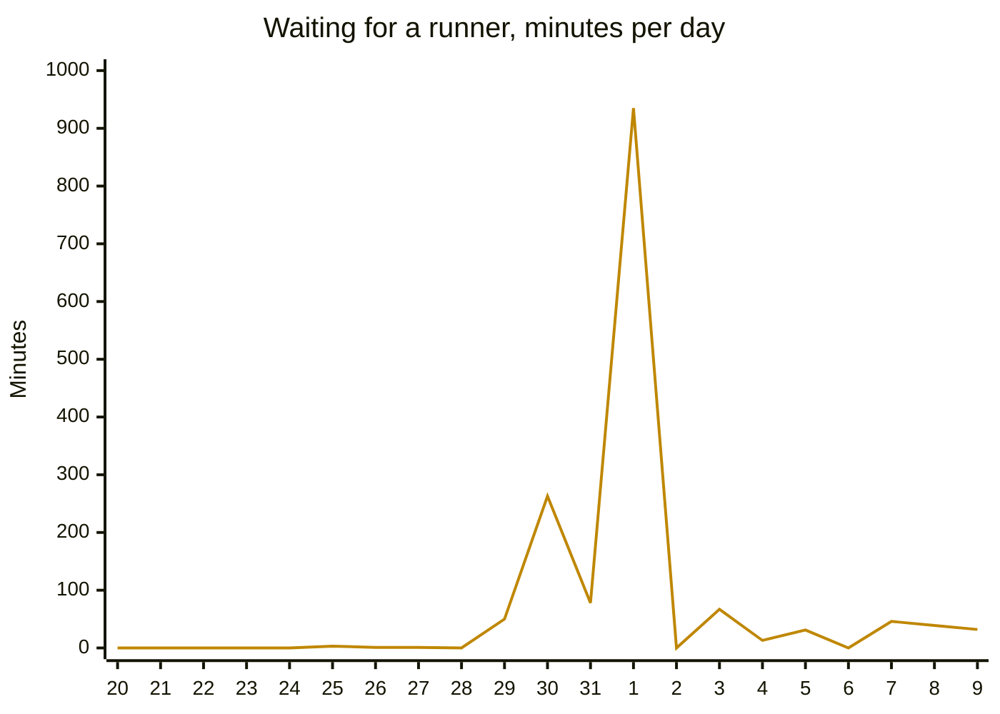

# DORA Report

The four DORA metrics for Whadio over three weeks, 20.10–09.11.2026, computed from the runs in
[`metrics-raw.md`](metrics-raw.md).

## Definitions

- **Deployment:** a green run of the `CI/CD` workflow on `main`. Nothing is deployed to production
  yet, so every green build on `main` counts as releasable (continuous delivery). The figures are
  an approximation of DORA's.
- **Workflows counted:** `CI/CD` only. `Release` also runs on pushes to `main` but only publishes
  versions, and `Commit messages` runs on pull requests only.
- **Runs:** 130 runs: 94 green, 16 red and 20 cancelled. Our workflow keeps one waiting run on
  `main`, so a newer push cancels a queued run. Cancelled runs are not completed runs; their pull
  requests count towards the next green run.
- **Lead time:** for each of the 157 pull requests that reached a green run in the period, from its
  first commit to the end of that run. 27 of them were merged on 18–19.10, while `main` was red.
- **Recovery:** from the end of each red run to the end of the next green run.

## Metrics

| Metric | Formula | Result | Level (by the median) → DORA 2025 share at this level or better |
| --- | --- | :---: | --- |
| Deployment frequency | green runs / weeks | 94 / 3 = **31 a week** (4.5 a day) | on demand → 16.2% |
| Change lead time | first PR commit → end of the green run with it | median **25.8 h**, mean 53.3 h | a day to a week → 56.4% |
| Change fail rate | red / completed runs | 16 / 110 = **14.5%** | 8–16% → 62.2% |
| Failed deployment recovery time | red run → next green run | median **14.2 h**, mean 50.4 h (16 runs) | under a day → 56.5% |

- The 18 release-bot changes count as deployments; without them the frequency is 25 a week and the
  median lead time 31.5 h.
- 6 of the 21 days had no green run: 20–24.10, while `main` was red (nobody merged on 22–24.10),
  and 06.11, with no merges.

| Indicator (CircleCI) | Target | CircleCI data, 2025 | Whadio |
| --- | :---: | :---: | :---: |
| Runs on `main` that succeed | 90% | 70.8% | 85.5% |
| Time to get `main` green again | ≤ 60 min | 59.2 min (median) | 14.2 h (median) |
| Workflow duration | ≤ 10 min | 2.2 min (median) | 9.5 min (median, green runs) |

## Where the Lead Time Goes

| Part of the lead time | Share of all lead time | Median per PR |
| --- | ---: | ---: |
| Before merge: writing, review, rework | 38.4% | 10.9 h |
| After merge, waiting for a green `main` | 60.5% | 0 min |
| Queue before the first job | 0.6% | 1 min |
| Run | 0.5% | 9 min |

- **Queue vs run:** of the time CI itself adds, the queue is 56% and the run 44%. 73% of that
  queue is one run on the midterm eve (row 75), which waited 4.4 h with 9 pull requests in it.
- **Inside runs:** 40% of the run time is also waiting, for a free runner between jobs.
- **When the queue builds:** most runs start at once (median queue 0 min). All but one of the runs
  that waited 15 min or more fell in the four days before the midterm. On 01.11 our runs waited
  15.6 h for runners in total, and one 41-minute run took 5.7 h.

## Reading the Pairs

- **Speed:** we deploy several times a day, and CI adds about 10 minutes, 1% of the lead time. A
  change still takes 26 h (median); across all changes, 60% of the time is waiting for a red `main`
  to go green.
- **Stability:** the 14.5% fail rate overstates our defects. One of the 16 red runs was a defect of
  the change; 14 came from outside (GitHub billing, new advisories in locked packages) and one was
  a flaky test.
- **Together:** the high frequency hides the cost of a red `main`. Nobody owned it, so it stayed red
  for days, 5.5 at worst. Since the audit stopped failing runs (01.11) and
  `CI passed` became a required check (02.11), `main` has had no red run in 8 days.

## Red Runs on `main`

A blameless review of each episode of consecutive red runs; the numbers are the rows of
[`metrics-raw.md`](metrics-raw.md).

| Episode | Runs | What failed | Why the PR checks missed it | Check to add |
| --- | --- | --- | --- | --- |
| 20.10–25.10, **5.5 d** (7.3 d from 18.10) | 1–7, 10–12 | GitHub billing stopped the hosted runners; after the move to the course runners (#117), `uv audit` failed on advisories in locked packages. Fixed by #148. | Not a defect of the change: every PR failed the same way, and `main` required no check | Done: the audit warns and `CI passed` is required. Add a daily audit that opens an issue |
| 30.10, **9.1 h** | 34 | The generated API types were stale: #193 was merged after #199 had added their check. Fixed by #200. | The PR's checks ran on an outdated base | Require branches to be up to date before merging |
| 30.10–31.10, **20.4 h** | 40–43 | A new `joserfc` advisory failed the audit. Fixed by #223. | Not a defect of the change: the advisory failed every run | As in the first episode |
| 01.11, **24 min** | 60 | A SPA test that timed the transcript poll failed; the next run passed with no frontend change. #241 replaced the timing with a wait. | It depends on timing and passed in the PR | A manual workflow that repeats the tests to find flaky ones |

## Root Causes

**Technical**

- A blocking dependency audit failed runs on someone else's schedule: 10 of 16 red runs.
- Four runners serve the whole course, and each of our runs takes up to six jobs. The split into
  parallel jobs (01.11) kept the run time (9.0 → 9.5 min) but doubled its runner time (8.9 → 17.2
  min).
- Documentation-only pushes run the whole pipeline: 13 runs.
- A timing-dependent test (fixed).

**Organisational**

- Nobody owned a red `main`, and pull requests were merged on red until 02.11.
- Merges bunch before deadlines: 35% of the runs fell in the four days before the midterm.
- A pull request gets its first review after 5.8 h (median), and half of the time it is open comes
  after that review.
- Pull requests were merged without first taking in the latest `main`.

## Improvement Backlog

| Metric | Problem | Root cause | Action | Owner |
| :--- | :--- | :--- | :--- | :--- |
| Deployment frequency | Every figure is an approximation; 18 of 94 deployments are release commits | The application is not deployed anywhere yet, so a green run stands in for a deployment | Deploy the application to its public server from every green `main` run, and measure the four metrics from those deployments | `@Hukyl` |
| Deployment frequency | Days without merges, then 35% of the runs in four days | Work is merged on deadline eve | Merge a finished slice every day | `@t-zlata` |
| Change lead time | 38% of it before merge | Half of a PR's open time comes after its first review | A reviewer of the day who answers new and updated pull requests within half a working day | `@SquidBow` |
| Change lead time | Waits of up to 5.7 h on 01.11 | Six jobs per run on four shared runners | Skip CI for documentation-only pushes to save runner time | `@Hukyl` |
| Lead time, recovery time | 60% of all lead time waiting for a green `main`; recovery median 14.2 h, up to 5.5 d | Nobody owned a red `main` | A weekly `main` owner who fixes or reverts a red run within an hour | `@v-missirova` |
| Recovery time | Red runs noticed late | GitHub notifies only whoever triggered the run | Post red `main` runs to the team chat | `@SquidBow` |
| Change fail rate | 10 of 16 red runs from the audit | A new advisory failed every run | Done: the audit warns (01.11). Add a daily audit that opens an issue | `@Hukyl` |
| Change fail rate | Stale API types on `main` | Checks ran on an outdated base | Require up-to-date branches in the `main` ruleset | `@Hukyl` |
| Change fail rate | A flaky test | It depended on timing | Done: fixed in #241. Add a manual flaky-test workflow | `@t-zlata` |

## Dashboard

The metrics table above, with two charts. Completed runs on `main` by start day; the red part is
the red runs.

```mermaid
%%{init: {"themeVariables": {"xyChart": {"plotColorPalette": "#2da44e, #cf222e"}}}}%%
xychart-beta
    title "Runs on main per day, 20.10–09.11"
    x-axis [20, 21, 22, 23, 24, 25, 26, 27, 28, 29, 30, 31, 1, 2, 3, 4, 5, 6, 7, 8, 9]
    y-axis "Runs" 0 --> 16
    bar [4, 2, 0, 0, 0, 5, 9, 6, 1, 3, 8, 6, 14, 0, 16, 5, 6, 0, 5, 14, 6]
    bar [4, 2, 0, 0, 0, 4, 0, 0, 0, 0, 4, 1, 1, 0, 0, 0, 0, 0, 0, 0, 0]
```

Minutes our runs waited for a runner, before and between jobs, by start day.

**Key finding.** CI is not what slows us down: the queue and the run are 1% of the lead time. A
red `main` that nobody owned is: waiting for it to go green is 60% of all lead time, and 14 of the
16 red runs came from outside our code.

**Action for next week.** A weekly `main` owner who fixes or reverts a red run within an hour.

## AI Usage

The run data was collected with `gh` and analysed, and both documents were drafted, with Claude
Code; Andrii Shalaiev reviewed them.
