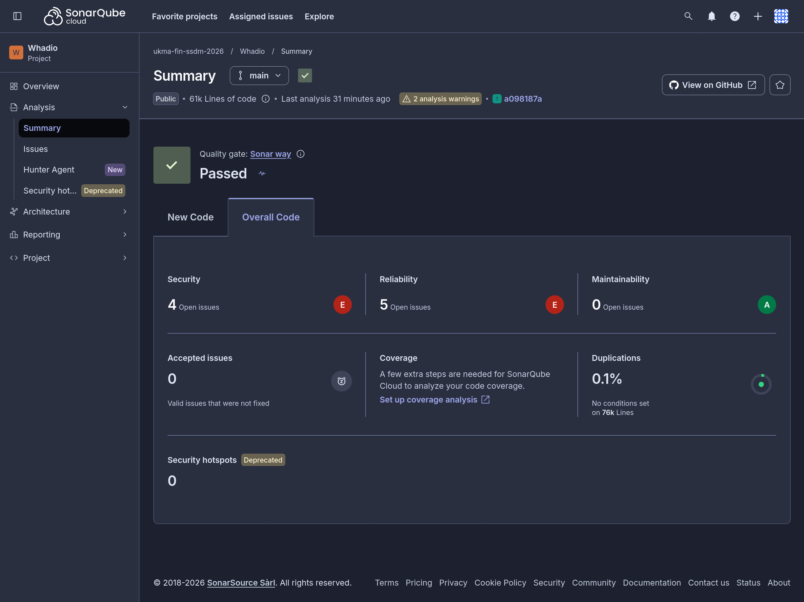
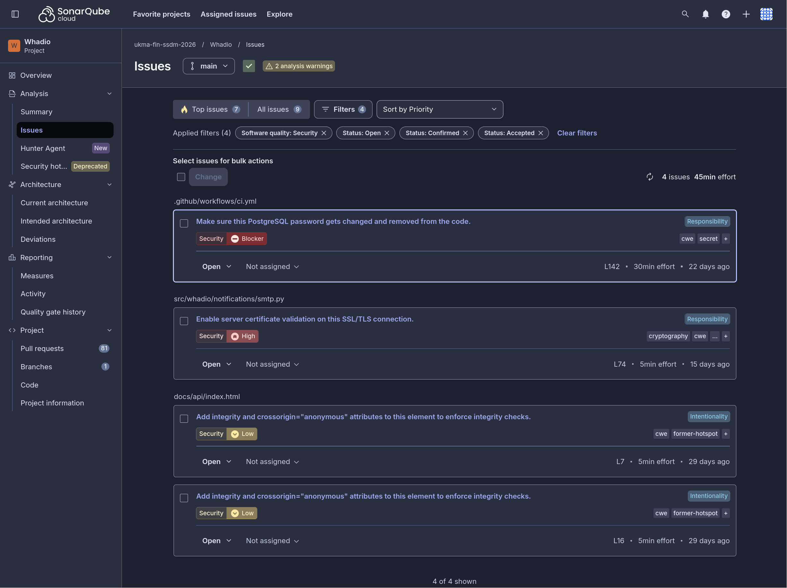
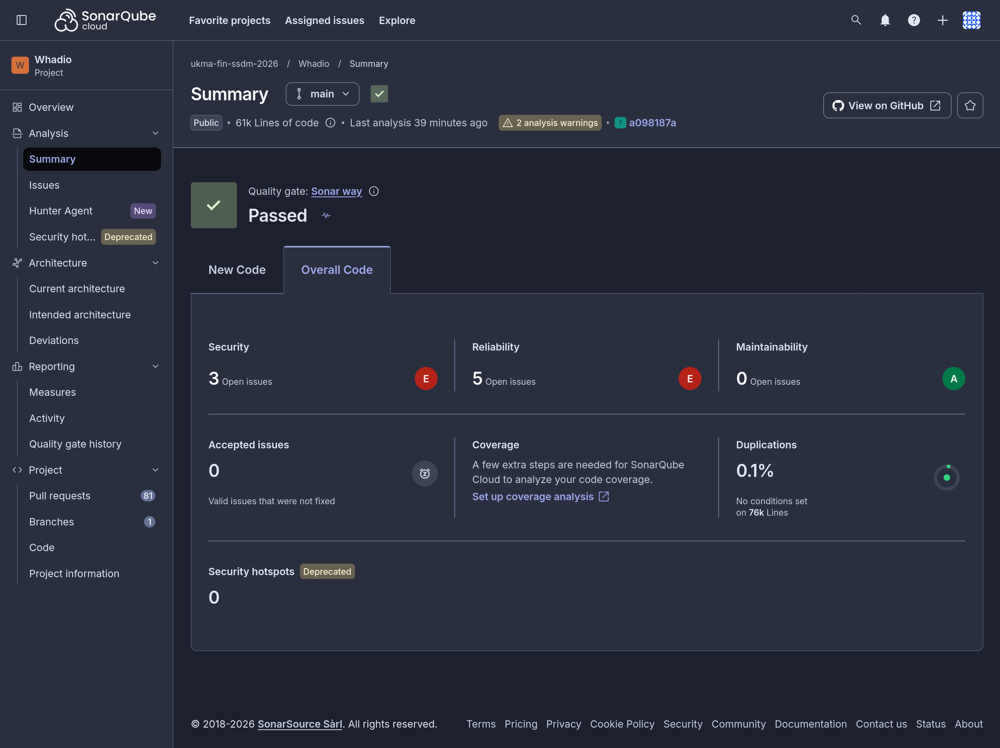
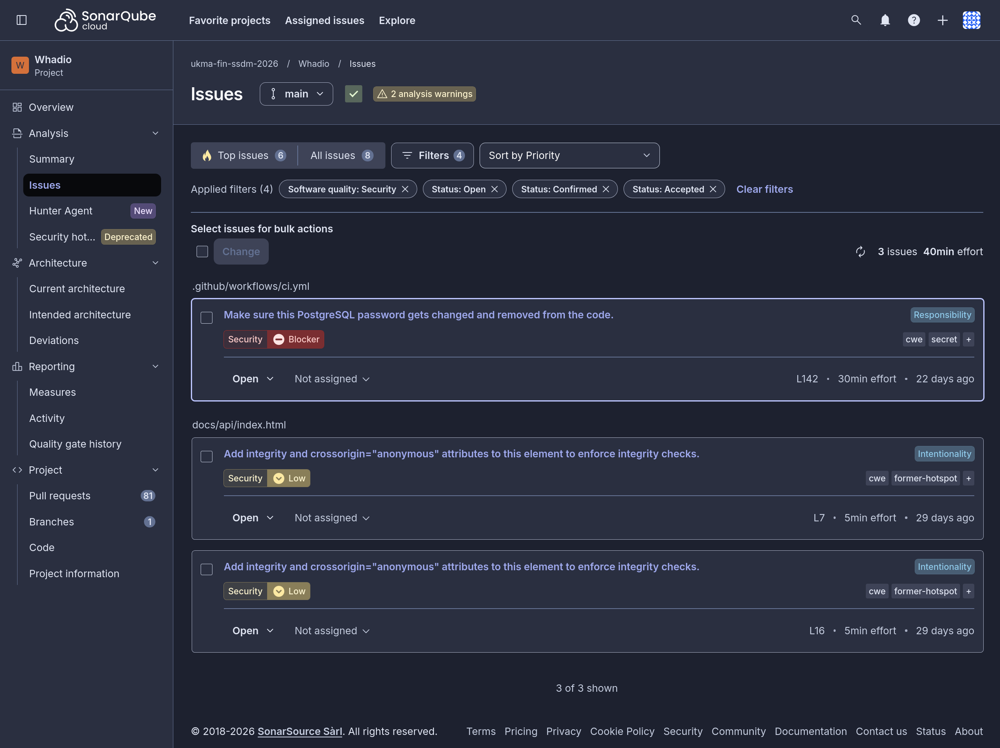
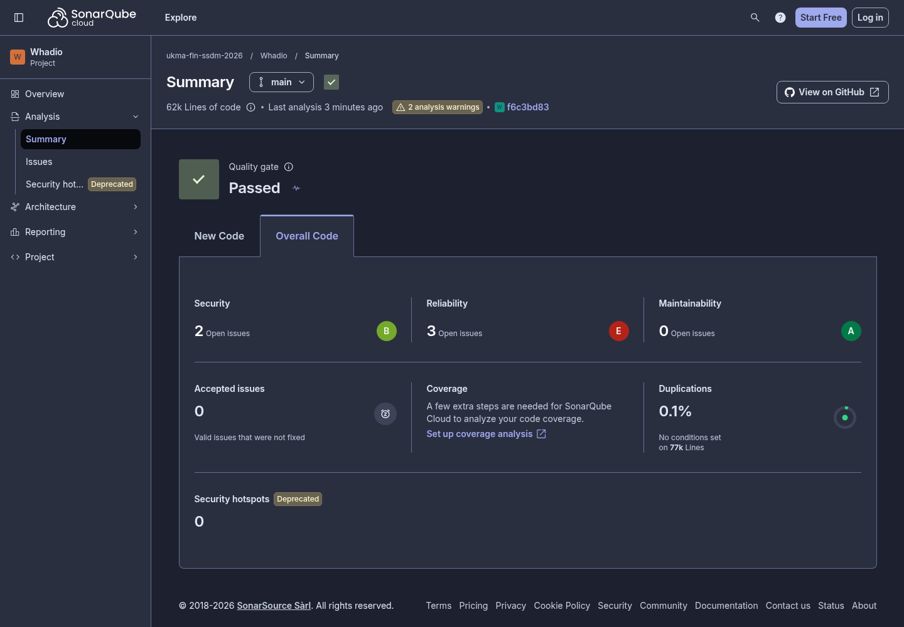
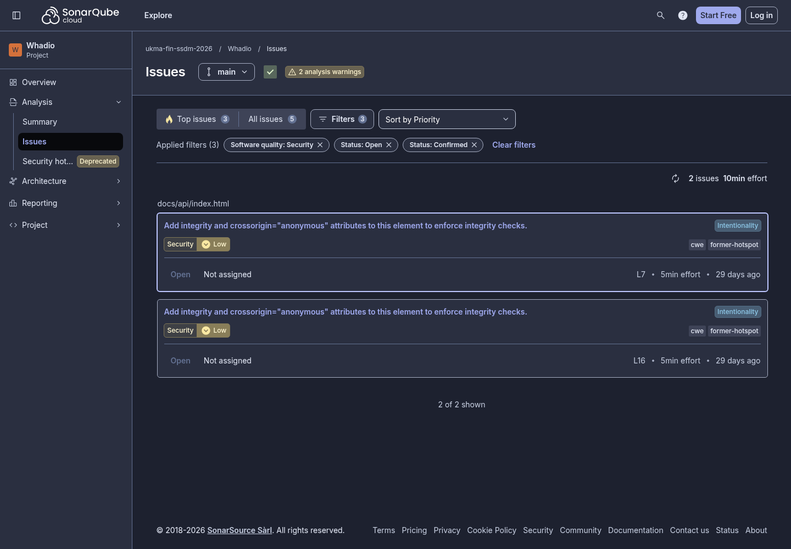

# SonarQube Cloud Refactoring Report

- Project: [Whadio in SonarQube Cloud](https://sonarcloud.io/project/overview?id=ukma-fin-ssdm-2026_Whadio)
- GitHub issue: [#265](https://github.com/ukma-fin-ssdm-2026/Whadio/issues/265)
- Baseline revision: `bc3ec9991bf1e7cde0a6475a2f13fef47ad56d73` (`main`, tagged `v0.1.0`)
- Baseline recorded: 2026-11-02
- After revision: `f6c3bd83a75699caccc20634b3d6bfd35ef989ec` (`main`, release `0.1.2`)
- After recorded: 2026-11-03

Every refactoring has its own pull request:

| # | Refactoring | Pull request | Released in |
| ---: | --- | --- | --- |
| 1 | Substitute Algorithm for the trailing-slash regex | [#267](https://github.com/ukma-fin-ssdm-2026/Whadio/pull/267) | 0.1.1 |
| 2 | Move Sensitive Data Out of Code in the CI workflow | [#273](https://github.com/ukma-fin-ssdm-2026/Whadio/pull/273) | 0.1.1 |
| 3 | Extract Function on `Upload.send`, after characterization tests ([#274](https://github.com/ukma-fin-ssdm-2026/Whadio/pull/274)) | [#276](https://github.com/ukma-fin-ssdm-2026/Whadio/pull/276) | 0.1.1 |
| 4 | Capture assembly moved out of the event loop | [#279](https://github.com/ukma-fin-ssdm-2026/Whadio/pull/279) | 0.1.2 |
| 5 | Recorder messages dispatched from a table, after characterization tests | Pending | Pending |

## Metrics

Security Rating is recorded independently, as required. The three selected improvement indicators
are Code Smells, Technical Debt, and Duplicated Lines. Reliability Rating is recorded for reference:
its findings are bugs, not code smells.

| Metric | Before (`bc3ec99`) | After (`f6c3bd8`) | Selected target |
| --- | ---: | ---: | --- |
| Code Smells | 1 | 0 | Yes |
| Technical Debt | 20 min (0.33 h) | 0 min | Yes |
| Duplicated Lines | 0.1% (4 blocks) | 0.1% (4 blocks) | Yes |
| Security Rating (required) | E (4 vulnerabilities) | B (2 vulnerabilities) | Always recorded |
| Maintainability Rating | A | A | Reference |
| Reliability Rating | E (4 bugs) | E (3 bugs) | Reference |

Refactoring 1 removed the only code smell and with it all 20 minutes of debt. Duplicated Lines did
not move: all four duplicated blocks are in test files (`src/whadio/api/test_composition.py`,
`src/whadio/api/meetings/test_routes_content.py` and `src/whadio/api/accounts/test_schemas.py`),
and no refactoring targeted them. The new characterization tests of Refactoring 3 added no
duplicated block. Refactoring 3 also lowered the Cognitive Complexity of `extension/background.js`
from 64 to 57.

### Security Rating: E before, B after

Four open security findings caused the E:

- `secrets:S6698` (Blocker): the literal PostgreSQL password in `.github/workflows/ci.yml:142`;
- `python:S4830`: `src/whadio/notifications/smtp.py:74`, likely a false positive because
  `ssl.create_default_context()` verifies the certificate and a regression test covers it;
- `Web:S5725` twice: Swagger UI assets lack Subresource Integrity in `docs/api/index.html:7` and
  `docs/api/index.html:16`.

The remediation and false-positive review are tracked in [issue #167](https://github.com/ukma-fin-ssdm-2026/Whadio/issues/167).
They are also connected to the [static-analysis findings](../code-quality/static-analysis.md) and
the threat model's [R-11 STARTTLS control](../architecture/threat-model.md#identified-risks).

The rating follows the most severe open vulnerability, so it moved in two steps:

1. `python:S4830` was reviewed and [resolved as a false positive](https://sonarcloud.io/project/issues?id=ukma-fin-ssdm-2026_Whadio&open=AaF0Yp8tXMYMJHNhzNMU)
   on 2026-11-03. `ssl.create_default_context()` sets `verify_mode=CERT_REQUIRED` and
   `check_hostname=True`, and `test_starttls_verifies_the_certificate_of_the_relay` asserts both on
   the context passed to `starttls()`. The rating stayed E, because the blocker was still open.
2. Refactoring 2 removed `secrets:S6698`, the blocker, and the rating rose to B.

B is the current value: the two minor `Web:S5725` findings remain. Swagger UI is loaded from
`unpkg.com/swagger-ui-dist@5` without Subresource Integrity. The planned fix, in #167, pins an exact
version and adds `integrity` and `crossorigin="anonymous"` to both tags, which would reach A.

### Why Reliability Rating remains E

The regular-expression finding is a code smell and does not affect Reliability Rating. Reliability
E came from `python:S930` in `src/whadio/api/composition.py:237` (a FastAPI `Depends` false
positive), `javascript:S2871` and `javascript:S9383` in `extension/recorder.js:22,339`, and
`python:S7493` in `src/whadio/capture/services.py:234`. Refactoring 4 cleared `python:S7493`, and
Refactoring 5 clears both extension bugs. The blocker `python:S930` keeps the rating at E until it
is resolved as a false positive.

## Dashboard evidence

### Before: `main` at `bc3ec99`

The baseline Measures view shows one maintainability issue in `frontend` and 20 minutes of debt.

The summary was taken on `a098187`, a documentation-only commit after `bc3ec99`, so it shows the
baseline code: Security E with 4 open issues, Reliability E, Maintainability A, 0.1% duplication.

### PR #267 analysis preview

The PR dashboard shows a passed Quality Gate, zero new issues, and zero new duplication.

### After the false-positive review of `python:S4830`

### After: `main` at `f6c3bd8`

## Refactoring 1: replace the trailing-slash regular expression

- SonarQube issue: [super-linear regular expression in `client.ts`](https://sonarcloud.io/project/issues?id=ukma-fin-ssdm-2026_Whadio&open=AaGLwuFO07PuiwrSX16p)
- Rule: `typescript:S8786`
- Location: `frontend/src/shared/api/client.ts:6`
- Smell: the trailing-slash regular expression can take super-linear time because of backtracking.
- Risk context: its only current input is the operator-controlled, build-time `VITE_API_ORIGIN`,
  so this was not an exploitable ReDoS. Removing it clears the debt and keeps the helper safe if it
  is reused with other input.
- Estimated debt: 20 minutes.
- Refactoring technique: **[Substitute Algorithm](https://refactoring.com/catalog/substituteAlgorithm.html)**.
- Behaviour that remains unchanged: an undefined origin still becomes an empty string; every
  trailing slash is removed; the URL, path prefix, and non-trailing slashes remain unchanged.
- Structural change: replace the regular expression with a backward index scan followed by one
  `slice`, giving linear time and constant auxiliary space.
- Proving test: `frontend/src/shared/api/client.test.ts` covers undefined and empty inputs, one and
  several trailing slashes, a path prefix, internal repeated slashes, and a 100,000-character
  trailing-slash suffix.
- Status: merged in PR #267 and released in 0.1.1. The `main` analysis after it shows zero code
  smells and zero debt.

## Refactoring 2: move the CI database password out of the code

- SonarQube issue: [PostgreSQL password in the CI workflow](https://sonarcloud.io/project/issues?id=ukma-fin-ssdm-2026_Whadio&open=AaF0Yp-HXMYMJHNhzNMm)
- Rule: `secrets:S6698` (Blocker)
- Location: `.github/workflows/ci.yml:142`, the backend job's `WHADIO_TEST_DATABASE_URL`
- Smell: a secret in code. The test database URL repeated the password of the `whadio_app` role.
- Risk context: the value is the public development default from `.env.example`, used only by
  throwaway local and CI databases, so nothing needed rotating. Still, a change of that default
  would have broken CI, and this one finding held the Security Rating at E.
- Refactoring technique: **Move Sensitive Data Out of Code** (Lecture 8, §9.3).
- Behaviour that remains unchanged: the backend job runs the whole suite against the same
  PostgreSQL database, role and password.
- Structural change: the step asks the application's `DatabaseSettings` for the URL. Those settings
  read the `.env` that the job copies from `.env.example` and that Compose created the role from,
  so the password exists in one place.
- Proving test: the backend CI job. It ran 1,703 tests, with 4 skipped and 8 deselected, on #273,
  exactly as on `main` before it. The PostgreSQL tests skip without a URL and fail on a wrong
  password, so equal counts mean they connected. SonarQube's analysis closed `secrets:S6698`.
- Status: merged in PR #273 and released in 0.1.1.

## Refactoring 3: extract the upload steps from `Upload.send`

- Rule: none. SonarQube showed no maintainability issue after Refactoring 1, so this is the lab's
  fallback: the function with the highest Cognitive Complexity in a module without tests.
- Location: `Upload.send` in `extension/background.js`
- Smell: Long Method with high Cognitive Complexity. `Upload.send` mixed three jobs in its retry
  loop: uploading the chunks the server lacks, deciding whether a failure ends the upload, and
  asking the server which chunks it holds. Its Cognitive Complexity was 20 by Biome's
  `noExcessiveCognitiveComplexity` rule (the Lab 5 linter), above the usual limit of 15.
- Refactoring technique: **[Extract Function](https://refactoring.com/catalog/extractFunction.html)**,
  with **[Decompose Conditional](https://refactoring.com/catalog/decomposeConditional.html)** for the
  give-up test.
- Behaviour that remains unchanged: chunking, the retry schedule and budget, the stop on 401 and
  404, the server query before each retry, and the local save of a failed upload.
- Structural change: `uploadPending` (with `uploadChunk`), `shouldGiveUp` and `syncReceived` each
  take one job, and `send` keeps only the loop.
- Proving test: `extension/background.test.js`, 15 characterization tests merged in #274 before the
  refactoring (Bonus 2). The same tests pass without a change before ([#274 CI](https://github.com/ukma-fin-ssdm-2026/Whadio/actions/runs/41548640541))
  and after ([#276 CI](https://github.com/ukma-fin-ssdm-2026/Whadio/actions/runs/41556532967)).
- Status: merged in PR #276 and released in 0.1.1.

| Cognitive Complexity | Before | After |
| --- | ---: | ---: |
| `Upload.send` (Biome) | 20 | 6 |
| `uploadPending` / `syncReceived` (Biome) | – | 3 / 3 |
| `extension/background.js` (SonarQube) | 64 | 57 |

## Refactoring 4: move capture assembly out of the event loop

- SonarQube issue: `python:S7493`, blocking file I/O in an async function
- Location: `CaptureService.complete` in `src/whadio/capture/services.py:234`
- Smell: the method created, wrote, rewound and closed a synchronous temporary file on the event
  loop, so slow disk operations could delay other requests.
- Refactoring technique: **Extract Function**, with `asyncio.to_thread` for the blocking assembly.
- Behaviour that remains unchanged: ordered chunk bytes, content type, authorization,
  missing-chunk checks, recording attachment, cleanup sources, queueing, idempotence and
  storage-error translation.
- Structural change: `_assemble` owns the temporary file, the chunk reads and the upload;
  `complete` keeps the async orchestration.
- Proving test: `src/whadio/capture/test_services.py`. Its 31 existing tests pass unchanged, both on
  `pre-refactor` and after the refactoring. Three added tests cover the temporary file created off
  the loop, cleanup after a cancelled upload, and a storage failure.
- Status: merged in PR #279 and released in 0.1.2.

## Refactoring 5: dispatch the recorder's messages from a table

- SonarQube issues: `javascript:S9383` (Major bug) and `javascript:S2871` (Critical bug)
- Locations: `extension/recorder.js:339`, the `ask-sign-in` message, and `extension/recorder.js:22`,
  the speaker sort. Together they held the file at Reliability D.
- Smells:
  - The `chrome.runtime.onMessage` listener was a chain of nine `if (message.type === ...)`
    branches, with a Cognitive Complexity of 13 by Biome.
  - Three branches repeated the same "show the card" steps. Only one of them ended its promise with
    `.catch`. The `ask-sign-in` copy did not, so a reloaded extension left an unhandled rejection
    (S9383).
  - `[...heard].sort()` had no compare function (S2871).
- Refactoring techniques:
  - **[Replace Conditional with Polymorphism](https://refactoring.com/catalog/replaceConditionalWithPolymorphism.html)**,
    in its lookup-table form: a `Map` from message type to handler.
  - **[Extract Function](https://refactoring.com/catalog/extractFunction.html)** for `showCard` and
    `refreshAndShowCard`, which merges the duplicated card steps.
- Behaviour that remains unchanged:
  - every answer to `status` and `stop`;
  - when the card shows, and its error;
  - that `show-error` does not check the sign-in;
  - the page port and the stop handshake;
  - silence for unknown types, including `toString`, which a plain object would resolve;
  - the order of the speakers sent to the background. The comparator sorts by UTF-16 code units,
    as the default sort did. `localeCompare` would have reordered Cyrillic and accented names.
- Intended change: `ask-sign-in` now swallows a rejected sign-in check, like `ask-consent` already
  did. This is the S9383 fix. It changes nothing a user sees, because the page cannot reach the
  extension at that point.
- Structural change: the listener is one line, `handlers.get(message.type)?.(message, sendResponse)`.
  Each handler has a Cognitive Complexity of at most 1, and the shared card steps live in one place.
- Proving tests: `extension/recorder.test.js`.
  - Before this refactoring, the file had no tests. 14 characterization tests were committed first,
    on the unchanged code, and pass unchanged after it.
  - A mutation check showed they are not vacuous: switching to `localeCompare`, dropping the
    `show-error` text, the `stopped` handling, the `stop` answer or the page port each turned at least one test red. One
    mutation survived: removing the `dismissed` reset from `ask-sign-in`, because it only affects
    later automatic re-shows.
  - A 15th test covers the S9383 fix. On the original code it fails with
    `Unhandled Rejection: Extension context invalidated.`; after the refactoring it passes.
- Status: pending review.

| Cognitive Complexity | Before | After |
| --- | ---: | ---: |
| `onMessage` listener (Biome) | 13 | ≤ 1 per handler |
| Sum over `extension/recorder.js` functions (Biome) | 61 | 50 |
| `extension/recorder.js` (SonarQube) | 94 | Pending analysis |
| `extension/recorder.js` bugs (SonarQube) | 2 (Reliability D) | Pending analysis |

## AI Usage

### Refactoring 1 (Codex)

Codex (GPT-5) generated the new `normalizeApiOrigin` function body, both added tests, and the first
draft of this report. The original prompt, before the catalog-name correction in peer review, was:

> SonarQube reports that the trailing-slash regular expression in `normalizeApiOrigin` has
> super-linear runtime due to backtracking. Apply Replace Algorithm and use a linear string
> operation instead. Preserve the handling of undefined and empty values, remove all trailing
> slashes, and leave the URL, path prefix, and non-trailing slashes unchanged. Add tests that prove
> the preserved behaviour and cover a long adversarial suffix.

The production diff was reviewed line by line before it was retained:

1. `origin ?? ""` preserves the existing undefined-input behaviour.
2. The end index starts at the original string length.
3. The loop is bounded by the string length and inspects only the trailing suffix.
4. The `end > 0` guard prevents an out-of-range access for empty and all-slash inputs.
5. Comparing only with `/` preserves every non-trailing character.
6. A single final `slice` returns the same normalized value without regex backtracking.
7. The added tests assert preserved observable behaviour rather than implementation details.

Peer review did not change the production algorithm: the reviewer fuzzed the old and new
implementations with 200,000 inputs and found no behavioural mismatch. It did expose an “80%
problem” in the generated evidence: the prompt called for an adversarial suffix, but a string that
ends in slashes is not the old regex's slow backtracking case. The test is still a useful behaviour
check, so its unsupported “in linear time” claim was removed. SonarQube's zero-issue PR analysis,
not that test, is the evidence that `typescript:S8786` is cleared. Review also corrected the catalog
name to Substitute Algorithm and expanded the metrics, security explanation, screenshots, test
evidence, and documentation index.

### Refactorings 2 and 3 and the bonuses (Claude Code)

Claude Code, directed by Andrii, generated:

- the CI change of Refactoring 2;
- the Vitest setup and the 15 characterization tests of #274, and the refactoring of #276;
- the release workflow, the git-cliff configuration and the release script (#277, #280);
- the first draft of those sections of this report.

Andrii chose the findings, the techniques and the release design, and reviewed each diff before it
was pushed. The changes were verified by:

- CI on each pull request: the whole suite with the integration services, and SonarQube's analysis;
- a mutation check of the characterization tests: removing or changing any one of 16 behaviours of
  `background.js` turned at least one test red;
- a local dry run of the release script, which changed exactly the eight version files, and a run
  of the GitHub CLI install step inside the runners' image, `ghcr.io/actions/actions-runner`.

Review caught five problems in the generated changes, the "80% problem" again. The required
Quality Gate caught three:

- `yaml:S2068`: `hide_password=False` read as a hard-coded credential (#273);
- `shell:S8541`: `uv run` without `--no-build` in the release script (#277);
- `githubactions:S6506`: `curl` following redirects without HTTPS-only (#280).

People caught two more:

- Valeriia found that the release tag trusted a commit message any pull request title could fake
  (#277).
- Andrii found that the workflow relied on a GitHub CLI the runners do not have, which the first
  run on `main` confirmed (#280).

Every one was fixed. The release then worked on its first run after #280.

### Refactoring 4 (Codex)

Codex (GPT-6.1) generated the extraction, the cancellation guard, the three added tests and the
first pull-request text, from this prompt:

> ok let's fix 7493 in capture/services.py. use extract function and move the file work
> to asyncio.to_thread. keep chunk order, upload, error handling and queueing working the same.
> run exissting tests on pre-refactor branch, then run the
> same tests after refactoring and add tests for the thread, storage errors and cancellation.

The cancellation test and its claims were revised against review on #279 and checked with mutation
runs: the test passed five repeated runs with the cancellation shield and failed five with it
removed.

### Refactoring 5 (Claude Code)

Claude Code (Claude Opus 5.5), directed by Denys, generated the characterization tests, the
refactoring and the first draft of this section. The request was Zlata's task for Lab 8: fix a
SonarQube problem and refactor it as #265 requires.

Claude Code picked the two open `extension/recorder.js` bugs because they were the only open
findings with a code fix. The other open findings are `python:S930`, a false positive, and the two
`Web:S5725` findings tracked in #167.

The diff was reviewed line by line before the commit, and review changed one thing. The first
draft reset `dismissed` inside `showCard`, which runs after the asynchronous sign-in check. A
`hide-card` that arrived during that check would then have been undone. The reset was moved back
before the check, where the original code had it.

## Verification log

### Refactoring 1

| Step | Command | Result |
| --- | --- | --- |
| Before refactoring | `npm --prefix frontend test -- src/shared/api/client.test.ts` | 5 tests passed |
| After refactoring | `npm --prefix frontend test -- src/shared/api/client.test.ts` | 7 tests passed |
| Type checking | `npm --prefix frontend run typecheck` | Passed |
| Frontend checks | `npm --prefix frontend run check -- src/shared/api/client.ts src/shared/api/client.test.ts` | Passed |
| Full frontend suite | `npm --prefix frontend test` | 52 files and 731 tests passed |
| Production build | `npm --prefix frontend run build` | Passed |
| Repository checks | `uv run task check` | Passed |
| Service-independent backend suite | `uv run task test:fast -- --basetemp=.venv/pytest-temp-265-fast` | 1,072 tests passed |
| Complete local suite | `uv run task test -- --basetemp=.venv/pytest-temp-265` | 1,097 passed, 609 skipped, 9 environment-dependent failures |
| [PR #267 CI](https://github.com/ukma-fin-ssdm-2026/Whadio/actions/runs/41520517060) | All required jobs | Passed with integration services |

The complete suite was attempted as required. Eight unrelated slow integration tests could not
connect to local Mailpit, RabbitMQ, or SeaweedFS because the Compose services were not running. One
model test could not access the gated `pyannote/speaker-diarization-community-1` repository without
an authorized Hugging Face token. None of the failures exercise the frontend files changed by this
refactoring. The 609 local skips primarily cover PostgreSQL-backed tests when
`WHADIO_TEST_DATABASE_URL` is unset, plus other environment-specific paths. PR #267 CI supplied the
integration services, ran the backend tests and coverage job successfully, and remains the
authoritative full-suite result.

### Refactorings 2 to 4

| Pull request | Check | Result |
| --- | --- | --- |
| [#273](https://github.com/ukma-fin-ssdm-2026/Whadio/actions/runs/41548716830) | Backend tests and coverage | 1,703 passed, 4 skipped, 8 deselected, as on `main` before it |
| [#274](https://github.com/ukma-fin-ssdm-2026/Whadio/actions/runs/41548640541) | Extension tests, before the refactoring | 15 passed |
| [#276](https://github.com/ukma-fin-ssdm-2026/Whadio/actions/runs/41556532967) | Extension tests, after the refactoring | The same 15 passed |
| [#279](https://github.com/ukma-fin-ssdm-2026/Whadio/pull/279) | Capture service tests | 31 existing passed before and after, 3 added passed |

### Refactoring 5

| Step | Command | Result |
| --- | --- | --- |
| Characterization, on the original code | `uv run task extension:test` | 29 passed: 15 upload, 14 recorder |
| After the refactoring | `uv run task extension:test` | 30 passed: the same 29 and the S9383 test |
| S9383 test, on the original code | `npx --prefix frontend vitest run --root extension recorder.test.js` | Unhandled rejection: the run fails |
| Lint | `npm --prefix frontend run check:extension` | Passed |

### Regression after all refactorings

The [CI run on `main` at `05e853e`](https://github.com/ukma-fin-ssdm-2026/Whadio/actions/runs/41565908627),
which contains all four refactorings, passed every job. No test failed.

| Suite | Result |
| --- | --- |
| Backend, with PostgreSQL, RabbitMQ, SeaweedFS and Mailpit | 1,706 passed, 4 skipped, 8 deselected; coverage 92.78% (gate 85%) |
| Frontend | 52 files, 731 tests passed |
| Extension | 15 tests passed |
| Static checks and audit, worker image | Passed |

Refactoring 4 added three tests: 1,703 before it, 1,706 after. The 4 skipped tests run against a
real Ollama (`WHADIO_TEST_OLLAMA_URL`), which CI does not start. The 8 deselected tests are marked
`models`: they need downloaded ML models, and `task test:cov` runs `pytest -m "not models"`.

## Release

- **Version.** The baseline is 0.1.0, tagged `v0.1.0` on `bc3ec99`. A pure refactoring is a patch,
  so Refactorings 1 to 3 were released as **0.1.1** and Refactoring 4 as **0.1.2**.
- **One number everywhere.** The same number appears in `pyproject.toml`, `uv.lock`,
  `frontend/package.json`, `extension/manifest.json`, the OpenAPI specification, `CHANGELOG.md` and
  the tag.
- **[`CHANGELOG.md`](../../CHANGELOG.md)** follows Keep a Changelog. Each release has a
  `## [X.Y.Z] - YYYY-MM-DD` heading and a `### Refactoring` category that names each technique.
- **The `[REFACTOR]` marker** is in each refactoring's commit message on `main` (#267, #273, #276,
  #279).
- **Automation.** A CI tool made both releases, with no manual step (Bonus 3):
  [`v0.1.1`](https://github.com/ukma-fin-ssdm-2026/Whadio/releases/tag/v0.1.1) and
  [`v0.1.2`](https://github.com/ukma-fin-ssdm-2026/Whadio/releases/tag/v0.1.2).

## Baseline branch

The local and remote `pre-refactor` branches point to the baseline revision above (`bc3ec999`) and
preserve the state of `main` before the refactoring.

## Bonuses

### 1. Quality Gate as a required check

- **Since 2026-11-03** the `main-checks` ruleset on `main` requires "SonarCloud Code Analysis", the
  Quality Gate. It also requires "CI passed" and the commit-message check, and allows no bypass.
  Approvals sit in a separate ruleset, `main-review`.
- **The gate stopped these pull requests**, each passing again after a fix:

  | Pull request | Stopped on | Finding | Green after |
  | --- | --- | --- | --- |
  | [#272](https://github.com/ukma-fin-ssdm-2026/Whadio/pull/272), a demonstration closed unmerged | [`c1421dd`](https://github.com/ukma-fin-ssdm-2026/Whadio/pull/272/checks?sha=c1421ddcb6081b987cded5c64374bcb2ffec52f9) | The regex of Refactoring 1 brought back. Every CI job passed; only the gate failed (Maintainability on new code E) and the merge was blocked. | [`bd5ec90`](https://github.com/ukma-fin-ssdm-2026/Whadio/pull/272/checks?sha=bd5ec9076dcd705b3f0f6bac05c749da93d62a71) |
  | [#273](https://github.com/ukma-fin-ssdm-2026/Whadio/pull/273), Refactoring 2 | [`5684c3e`](https://github.com/ukma-fin-ssdm-2026/Whadio/pull/273/checks?sha=5684c3edbf6814246214542a5ba0e086a8115340) | `yaml:S2068`, Security on new code C | [`bcfcccf`](https://github.com/ukma-fin-ssdm-2026/Whadio/pull/273/checks?sha=bcfcccfcd7084b5ff9870c62b549585d8781896f) |
  | [#280](https://github.com/ukma-fin-ssdm-2026/Whadio/pull/280), the release fix | [`b95c6ee`](https://github.com/ukma-fin-ssdm-2026/Whadio/pull/280/checks?sha=b95c6ee16e2cd24a869f5b5f4febb80e3c7cb1e5) | `githubactions:S6506`, Security on new code C | [`f54ca53`](https://github.com/ukma-fin-ssdm-2026/Whadio/pull/280/checks?sha=f54ca538226d8bb49ae33fdb606a1fd5009febed) |

### 2. Characterization tests before the refactoring

- **The module had no tests.** The extension had none at all before Lab 8.
- **What the tests pin.** [#274](https://github.com/ukma-fin-ssdm-2026/Whadio/pull/274) added 15
  characterization tests for the chunk upload in `extension/background.js`, odd behaviour included.
  For example, the five retries are counted across all chunks of one send, so a later chunk can
  fail on its first try. A call that ends before any audio leaves its capture open and saves
  nothing.
- **How they are written.** The tests drive the module only through Chrome's entry points, answer
  `fetch` from a fake server and use fake timers. They run with the frontend's Vitest, in CI and in
  a push hook.
- **Order on `main`.** The test commit
  [`3676260`](https://github.com/ukma-fin-ssdm-2026/Whadio/commit/367626034edaea752fe0691f4915f31944f4d148)
  lands before the refactoring commit
  [`6e12706`](https://github.com/ukma-fin-ssdm-2026/Whadio/commit/6e12706f7e3b8d9be15426296f04c25cf948b526)
  (Refactoring 3).
- **Same tests, before and after.** The 15 tests pass unchanged on both commits. A mutation check
  showed they are not vacuous.

### 3. Automated release

- **The tool.** Commit messages follow Conventional Commits. [git-cliff](../../cliff.toml) computes
  the version and the changelog section, and is configured so that `refactor` gives a patch.
- **The workflow.** [`release.yml`](../../.github/workflows/release.yml) runs a GitHub App, the
  release bot.
  - On every push to `main` with releasable commits, it opens or updates a release pull request
    that bumps every version and prepends the `CHANGELOG.md` section.
  - Once CI succeeds, it merges that pull request through the API. Its ruleset bypass covers only
    the approval; the required checks still gate the merge.
  - It then pushes the annotated tag and publishes a GitHub Release.
- **The runs that created the Lab 8 release:**
  - [prepare](https://github.com/ukma-fin-ssdm-2026/Whadio/actions/runs/41564328131) opened release
    pull request [#281](https://github.com/ukma-fin-ssdm-2026/Whadio/pull/281);
  - [merge](https://github.com/ukma-fin-ssdm-2026/Whadio/actions/runs/41565717563) merged it with
    no human approval;
  - [tag](https://github.com/ukma-fin-ssdm-2026/Whadio/actions/runs/41565744357) pushed `v0.1.1` and
    the GitHub Release.
- **The next release.** The same bot released Refactoring 4 as `0.1.2` through
  [#282](https://github.com/ukma-fin-ssdm-2026/Whadio/pull/282).
