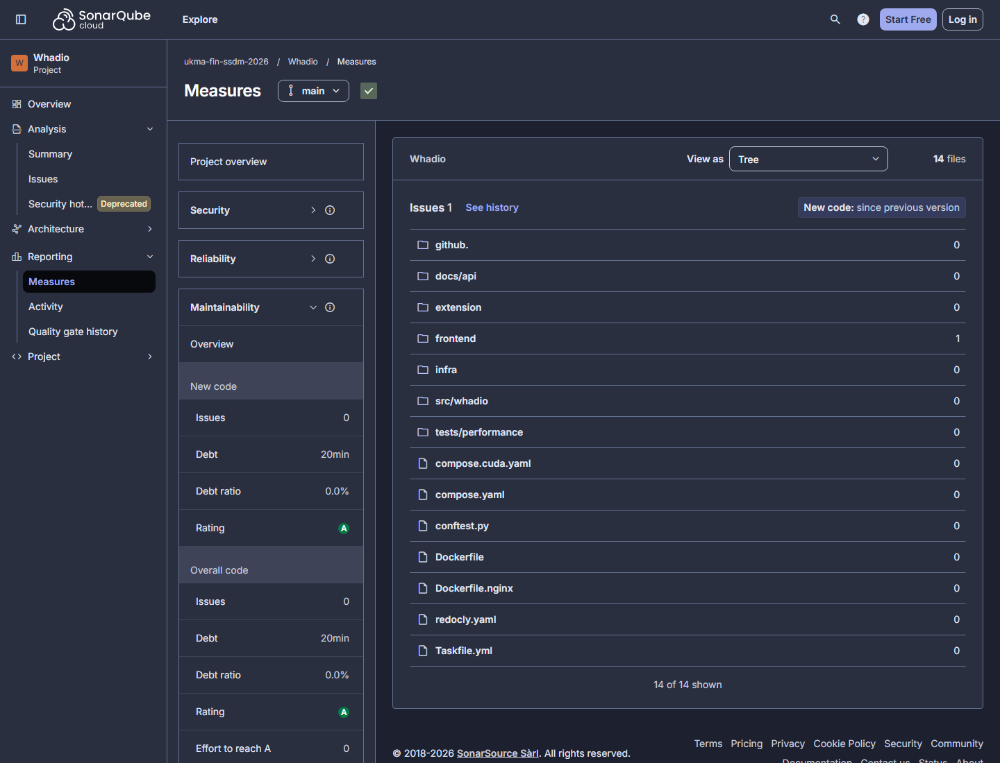
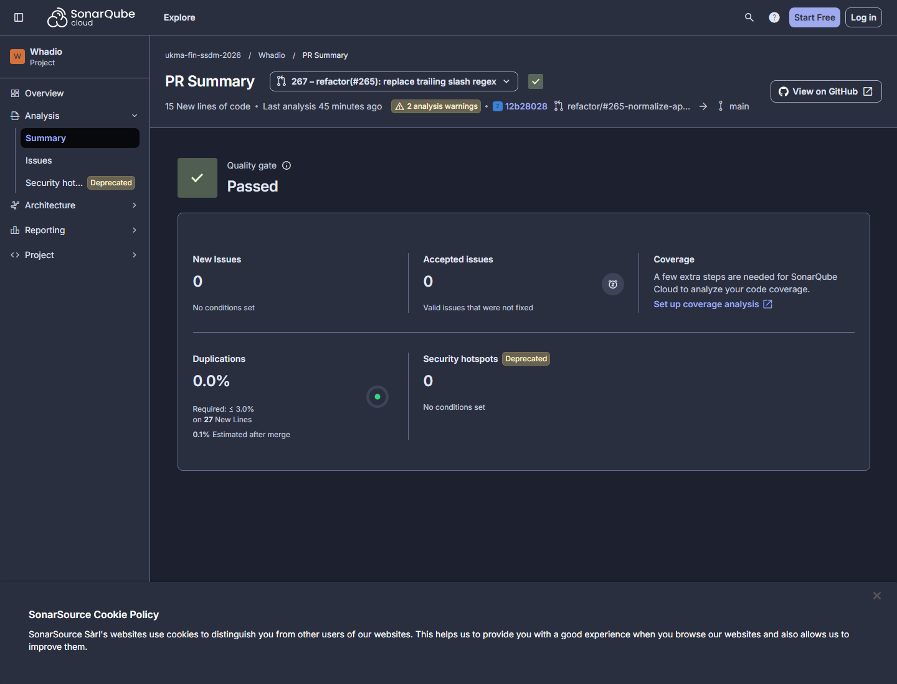

# SonarQube Cloud Refactoring Report

- Project: [Whadio in SonarQube Cloud](https://sonarcloud.io/project/overview?id=ukma-fin-ssdm-2026_Whadio)
- GitHub issue: [#265](https://github.com/ukma-fin-ssdm-2026/Whadio/issues/265)
- Baseline revision: `bc3ec9991bf1e7cde0a6475a2f13fef47ad56d73` (`main`)
- Baseline recorded: 2026-11-02

Refactoring 1 is tracked in [PR #267](https://github.com/ukma-fin-ssdm-2026/Whadio/pull/267).
Each later finding gets its own focused branch and pull request, and extends this report.

## Metrics

Security Rating is recorded independently, as required. The three selected improvement indicators
are Code Smells, Technical Debt, and Duplicated Lines. The first two measure the finding fixed in
PR #267. Duplication is the third target for a later fallback refactoring because Reliability E is
caused by four bugs outside this pure refactoring.

| Metric | Before | After PR #267 | Selected target |
| --- | ---: | ---: | --- |
| Code Smells | 1 | 0 expected after merge; the PR analysis cleared the issue | Yes |
| Technical Debt | 20 min (0.33 h) | 0 min expected after merge | Yes |
| Duplicated Lines | 0.1% | 0.1% estimated after merge | Yes |
| Security Rating (required) | E | E expected | Always recorded |
| Maintainability Rating | A | A expected | Reference |
| Reliability Rating | E | E expected | Reference |

The final “After” values will be copied from the first `main` analysis after merge rather than from
an estimate.

### Why Security Rating is E

Four open security findings cause the rating:

- `secrets:S6698` (Blocker): the literal PostgreSQL password in `.github/workflows/ci.yml:142`;
- `python:S4830`: `src/whadio/notifications/smtp.py:74`, likely a false positive because
  `ssl.create_default_context()` verifies the certificate and a regression test covers it;
- `Web:S5725` twice: Swagger UI assets lack Subresource Integrity in `docs/api/index.html:7` and
  `docs/api/index.html:16`.

The remediation and false-positive review are tracked in [issue #167](https://github.com/ukma-fin-ssdm-2026/Whadio/issues/167).
They are also connected to the [static-analysis findings](../code-quality/static-analysis.md) and
the threat model's [R-11 STARTTLS control](../architecture/threat-model.md#identified-risks).

### Why Reliability Rating remains E

The regular-expression finding is a code smell and does not affect Reliability Rating. Reliability
E comes from `python:S930` in `src/whadio/api/composition.py:237` (a FastAPI `Depends` false
positive), `javascript:S2871` and `javascript:S9383` in `extension/recorder.js:22,339`, and
`python:S7493` in `src/whadio/capture/services.py:234`. They require separate decisions and fixes;
therefore Reliability is recorded only as a reference metric for this refactoring.

## Dashboard evidence

### Before: `main` at `bc3ec99`

The baseline Measures view shows one maintainability issue in `frontend` and 20 minutes of debt.

### After: PR #267 analysis preview

The PR dashboard shows a passed Quality Gate, zero new issues, and zero new duplication. A final
post-merge `main` screenshot will be added with the confirmed “After” metrics.

## Refactoring 1: replace the trailing-slash regular expression

- SonarQube issue: [super-linear regular expression in `client.ts`](https://sonarcloud.io/project/issues?id=ukma-fin-ssdm-2026_Whadio&open=AaGLwuFO07PuiwrSX16p)
- Rule: `typescript:S8786`
- Location: `frontend/src/shared/api/client.ts:6`
- Smell: the trailing-slash regular expression can take super-linear time because of backtracking.
- Risk context: its only current input is the operator-controlled, build-time `VITE_API_ORIGIN`,
  so this was not an exploitable ReDoS. Removing it clears the debt and keeps the helper safe if it
  is reused with other input.
- Estimated debt: 20 minutes.
- Refactoring technique: **[Substitute Algorithm](https://refactoring.com/catalog/substituteAlgorithm.html)**.
- Behaviour that remains unchanged: an undefined origin still becomes an empty string; every
  trailing slash is removed; the URL, path prefix, and non-trailing slashes remain unchanged.
- Structural change: replace the regular expression with a backward index scan followed by one
  `slice`, giving linear time and constant auxiliary space.
- Proving test: `frontend/src/shared/api/client.test.ts` covers undefined and empty inputs, one and
  several trailing slashes, a path prefix, internal repeated slashes, and a 100,000-character
  trailing-slash suffix.
- Status: implemented in PR #267; its SonarQube analysis reports zero new issues and a passed
  Quality Gate. The final project metrics are recorded after the merge analysis.

## AI Usage

Codex (GPT-5) generated the new `normalizeApiOrigin` function body, both added tests, and the first
draft of this report. The original prompt, before the catalog-name correction in peer review, was:

> SonarQube reports that the trailing-slash regular expression in `normalizeApiOrigin` has
> super-linear runtime due to backtracking. Apply Replace Algorithm and use a linear string
> operation instead. Preserve the handling of undefined and empty values, remove all trailing
> slashes, and leave the URL, path prefix, and non-trailing slashes unchanged. Add tests that prove
> the preserved behaviour and cover a long adversarial suffix.

The production diff was reviewed line by line before it was retained:

1. `origin ?? ""` preserves the existing undefined-input behaviour.
2. The end index starts at the original string length.
3. The loop is bounded by the string length and inspects only the trailing suffix.
4. The `end > 0` guard prevents an out-of-range access for empty and all-slash inputs.
5. Comparing only with `/` preserves every non-trailing character.
6. A single final `slice` returns the same normalized value without regex backtracking.
7. The added tests assert preserved observable behaviour rather than implementation details.

Peer review did not change the production algorithm: the reviewer fuzzed the old and new
implementations with 200,000 inputs and found no behavioural mismatch. It did expose an “80%
problem” in the generated evidence: the prompt called for an adversarial suffix, but a string that
ends in slashes is not the old regex's slow backtracking case. The test is still a useful behaviour
check, so its unsupported “in linear time” claim was removed. SonarQube's zero-issue PR analysis,
not that test, is the evidence that `typescript:S8786` is cleared. Review also corrected the catalog
name to Substitute Algorithm and expanded the metrics, security explanation, screenshots, test
evidence, and documentation index.

## Verification log

| Step | Command | Result |
| --- | --- | --- |
| Before refactoring | `npm --prefix frontend test -- src/shared/api/client.test.ts` | 5 tests passed |
| After refactoring | `npm --prefix frontend test -- src/shared/api/client.test.ts` | 7 tests passed |
| Type checking | `npm --prefix frontend run typecheck` | Passed |
| Frontend checks | `npm --prefix frontend run check -- src/shared/api/client.ts src/shared/api/client.test.ts` | Passed |
| Full frontend suite | `npm --prefix frontend test` | 52 files and 731 tests passed |
| Production build | `npm --prefix frontend run build` | Passed |
| Repository checks | `uv run task check` | Passed |
| Service-independent backend suite | `uv run task test:fast -- --basetemp=.venv/pytest-temp-265-fast` | 1,072 tests passed |
| Complete local suite | `uv run task test -- --basetemp=.venv/pytest-temp-265` | 1,097 passed, 609 skipped, 9 environment-dependent failures |
| [PR #267 CI](https://github.com/ukma-fin-ssdm-2026/Whadio/actions/runs/41520517060) | All required jobs | Passed with integration services |

The complete suite was attempted as required. Eight unrelated slow integration tests could not
connect to local Mailpit, RabbitMQ, or SeaweedFS because the Compose services were not running. One
model test could not access the gated `pyannote/speaker-diarization-community-1` repository without
an authorized Hugging Face token. None of the failures exercise the frontend files changed by this
refactoring. The 609 local skips primarily cover PostgreSQL-backed tests when
`WHADIO_TEST_DATABASE_URL` is unset, plus other environment-specific paths. PR #267 CI supplied the
integration services, ran the backend tests and coverage job successfully, and remains the
authoritative full-suite result.

## Baseline branch

The local and remote `pre-refactor` branches point to the baseline revision above (`bc3ec999`) and
preserve the state of `main` before the refactoring.
